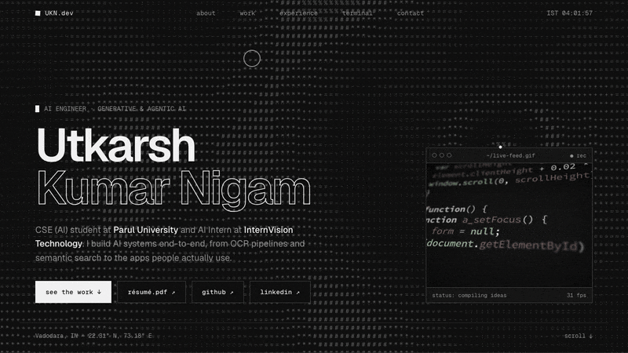
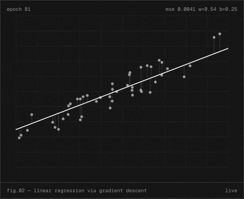
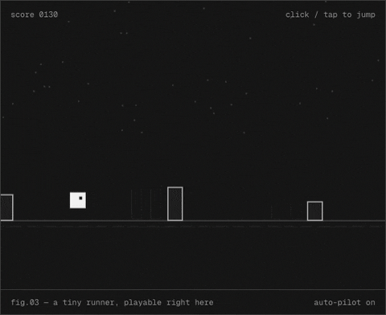
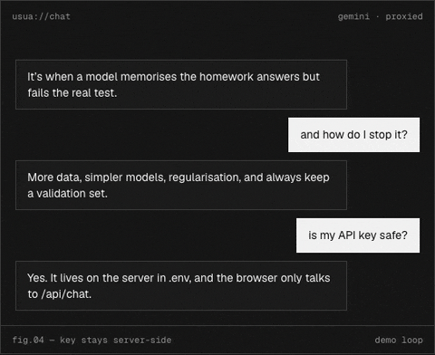
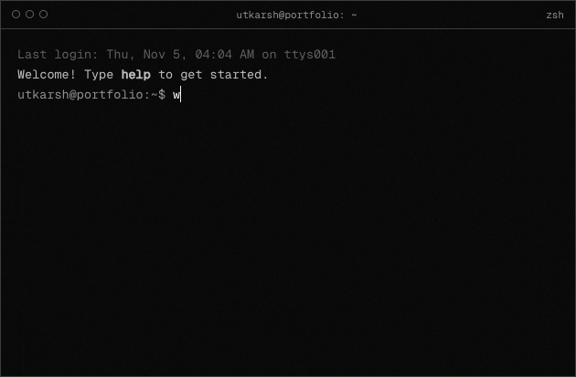

<!-- ============ HEADER ============ -->

<h1>Utkarsh Kumar Nigam</h1>

<code>AI ENGINEER · GENERATIVE &amp; AGENTIC AI · FULL-STACK</code>

  

  

 

<!-- ============ ABOUT ============ -->
<h2 align="center">About</h2>

<code>[01] — whoami</code>

<table align="center">
  <tr>
    <td width="60%" valign="top">
       
      <ul>
        <li>Pursuing <b>B.Tech in Computer Science &amp; Engineering (AI)</b> at <b>Parul University</b> (2025 – 2029).</li>
        <li><b>AI Intern</b> at <b>InternVision Technology Pvt. Ltd.</b>, working on <b>Generative AI &amp; Agentic AI</b> projects.</li>
        <li>Built <b>NyayaSetu</b>, an AI-driven judicial operations platform with OCR, semantic search and explainable analytics.</li>
        <li>Participated in <b>Smart India Hackathon (SIH) 2026</b>.</li>
        <li>Currently exploring <b>LLMs, AI agents and intelligent systems</b>.</li>
      </ul>
       
      <table>
        <tr><td><code>location</code></td><td>Vadodara, Gujarat, India</td></tr>
        <tr><td><code>focus</code></td><td>LLMs · agents · RAG · full-stack AI apps</td></tr>
        <tr><td><code>looking for</code></td><td>AI/ML or software engineering internships</td></tr>
      </table>
    </td>
    <td width="40%" valign="top" align="center">
      
       <code>actual footage of me at 2am</code>
    </td>
  </tr>
</table>

 

<!-- ============ PORTFOLIO ============ -->
<h2 align="center">Portfolio</h2>

<code>[02] — open https://utkarshkumarnigam-lab.github.io</code>

  <b>No screenshots, only live demos.</b> Each project on the site runs a small working sketch of what it does.

<table width="100%">
<tr>
<td width="50%" align="center" valign="top">
  
   <code>fig.01</code> LUKA: gradient descent, frame by frame
</td>
<td width="50%" align="center" valign="top">
  
   <code>fig.02</code> AIKI: a tiny runner you can play on the page
</td>
</tr>
<tr>
<td width="50%" align="center" valign="top">
  
   <code>fig.03</code> Usua: chat demo, with the API key kept server-side
</td>
<td width="50%" align="center" valign="top">
  
   <code>fig.04</code> A working terminal. Try <code>sudo hire utkarsh</code>
</td>
</tr>
</table>

  

 

<!-- ============ PROJECTS ============ -->
<h2 align="center">Selected work</h2>

<code>[03] — ls ./projects</code>

<table width="100%">
<tr>
<td width="50%" valign="top">

### NyayaSetu
<code>aug 2026 · SIH PS 1282</code>

AI-driven judicial operations platform. It helps court and prison staff see which undertrial cases need attention, using a 0–100 score from six explainable factors, OCR on FIRs and charge sheets, and semantic search with cited answers.

</td>
<td width="50%" valign="top">

### LUKA: DataSense AI
<code>jun 2026 · live</code>

A data science learning app that runs in the browser. Models train one frame at a time, so you can watch the regression line move as the loss drops. It also has a curriculum, quizzes and an AI mentor.

</td>
</tr>
<tr>
<td width="50%" valign="top">

### AIKI
<code>jul 2026 · playable</code>

An endless runner in React with no canvas, no game engine and no audio files. Every obstacle is a DOM element, and all the music is synthesised live with Web Audio oscillators.

</td>
<td width="50%" valign="top">

### Usua
<code>jul 2026 · live</code>

A ChatGPT-style chat client for Google Gemini. A small Node.js server proxies requests so the API key never reaches the browser, and chats are cleaned up automatically after 12 days.

</td>
</tr>
</table>

 

<!-- ============ STACK ============ -->
<h2 align="center">Tools I use</h2>

<code>[04] — cat stack.txt</code>

  
  
  
  
  
  
  
   
  
  
  
  
  
  
  
  
   
  
  
  
  
  
  

 

<!-- ============ CONTRIBUTIONS ============ -->
<h2 align="center">Contributions</h2>

<code>[05] — git log --graph</code>

<picture>
  <source media="(prefers-color-scheme: dark)" srcset="https://raw.githubusercontent.com/utkarshkumarnigam-lab/utkarshkumarnigam-lab/output/github-contribution-grid-snake-dark.svg" />
  <source media="(prefers-color-scheme: light)" srcset="https://raw.githubusercontent.com/utkarshkumarnigam-lab/utkarshkumarnigam-lab/output/github-contribution-grid-snake.svg" />
  
</picture>

 

<!-- ============ FOOTER ============ -->

  <code>utkarsh@github:~$ echo "turning ideas into working software, one commit at a time"</code>
    
  

